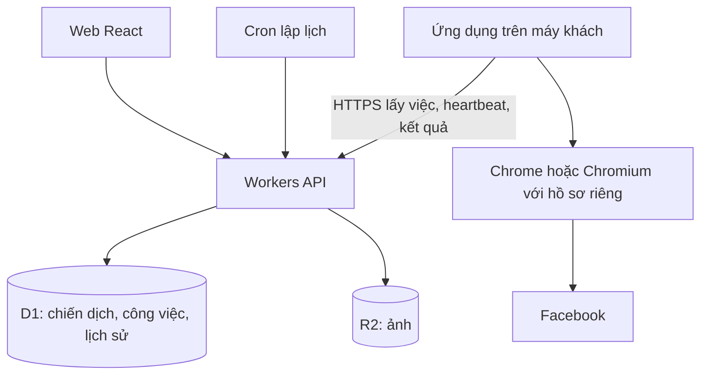

# Kế hoạch BotAds web và ứng dụng chạy trên máy khách

Ngày lập: 17/10/2026. Cập nhật: 20/10/2026. Đã triển khai bản thử local gồm React, API Workers theo MVC và ứng dụng Electron. Chưa deploy production; domain để sau theo yêu cầu người dùng. Xem [hướng dẫn sử dụng](docs/HUONG_DAN_SU_DUNG.md).

Phạm vi đã chốt: hai chế độ nội dung (tự soạn/chọn bài hoặc Gemini tạo), ảnh cho từng bài, bình luận kèm link, giới hạn tài khoản và chiến dịch tùy chỉnh (bản đầu 1–100), ghép một máy Windows bằng mã một lần, phiên Facebook lưu trên máy, lịch và kết quả trên web. Kiểm thử không thực hiện đăng bài Facebook thật. Các mục bên dưới là kiến trúc mục tiêu; thanh toán, cập nhật ứng dụng tự động và vận hành thương mại vẫn thuộc giai đoạn sau.

## 1. Quyết định kiến trúc

Xây web React trên Cloudflare để quản lý tài khoản, chiến dịch, nội dung, ảnh, lịch và kết quả. Đóng gói bộ chạy Node.js + Playwright thành ứng dụng Windows cài một lần. Ứng dụng nhận công việc từ web và điều khiển một hồ sơ trình duyệt riêng trên máy khách.

Giả định cho MVP: Windows, một thiết bị được chỉ định chạy mỗi tài khoản Facebook, một tài khoản Facebook mỗi workspace. Thiết kế dữ liệu cho nhiều workspace ngay từ đầu; mở rộng nhiều tài khoản sau khi bản đầu ổn định.

Website thông thường không có quyền tự mở và điều khiển Chrome của khách. Nếu chọn extension với native messaging, vẫn phải cài native host. Với code Node.js + Playwright hiện tại, ứng dụng companion là hướng ưu tiên để tái sử dụng. [Chrome Native Messaging](https://developer.chrome.com/docs/extensions/develop/concepts/native-messaging).

Dùng hồ sơ Chrome/Chromium riêng do ứng dụng quản lý. Playwright hiện không hỗ trợ tự động hóa hồ sơ Chrome mặc định của người dùng; không dựa vào việc lấy phiên đăng nhập từ Chrome cá nhân đang mở. [Playwright BrowserType](https://playwright.dev/docs/api/class-browsertype).

## 2. Trải nghiệm khách hàng

1. Đăng ký tài khoản sản phẩm và tạo workspace.
2. Tải ứng dụng BotAds cho Windows, cài một lần, chọn khởi động cùng Windows.
3. Ghép thiết bị bằng mã một lần có thời hạn; web hiển thị tên thiết bị và trạng thái kết nối.
4. Bấm Kết nối Facebook. Ứng dụng mở trình duyệt riêng; khách đăng nhập trực tiếp tại Facebook và tự hoàn thành 2FA nếu cần.
5. Tạo chiến dịch: thông tin sản phẩm, website, khách hàng mục tiêu, từ khóa tìm nhóm, prompt, mẫu bài, giọng văn, ảnh, bình luận kèm link.
6. Xem bản nháp AI và danh sách nhóm dự kiến. Chọn duyệt bài trước hoặc cho phép chạy tự động trong phạm vi chiến dịch đã cấu hình.
7. Chọn lịch, múi giờ, giới hạn ngày, khoảng nghỉ giữa các lần đăng lại một nhóm, rồi bật chiến dịch.
8. Xem tiến độ, link bài đã xác nhận, bài chờ duyệt, bài chưa rõ kết quả, trạng thái bình luận và lỗi cần xử lý trên web.

Khách không phải cài Node.js, mở source hoặc nhập lệnh npm. Đóng tab web vẫn chạy nếu ứng dụng đang chạy. Tắt máy, máy ngủ hoặc mất mạng thì việc mới chờ thiết bị. Windows cần phiên người dùng đang đăng nhập; kiểm thử hành vi khi khóa màn hình trong giai đoạn pilot. Phiên Facebook hết hạn hoặc có yêu cầu xác minh thì cần khách thao tác lại.

Không thiết kế form yêu cầu gửi mật khẩu Facebook lên backend. Phiên Facebook ở máy khách, bảo vệ bằng cơ chế lưu trữ hệ điều hành và quyền truy cập thư mục; không đồng bộ cookie hoặc ghi cookie vào log. Tài khoản đăng nhập SaaS tách biệt tài khoản Facebook.

## 3. Thành phần kỹ thuật

| Thành phần | Đề xuất | Trách nhiệm |
| --- | --- | --- |
| Web | React + Vite, Workers Static Assets | Dashboard, nhập prompt, ảnh, lịch, kết quả |
| API | Cloudflare Workers, JavaScript; ưu tiên TypeScript cho phần mới | Xác thực, phân quyền, chiến dịch, giao việc, nhận sự kiện |
| Dữ liệu | Cloudflare D1 | Workspace, thiết bị, chiến dịch, công việc, lịch sử, hạn mức |
| Ảnh | Cloudflare R2 private | Lưu ảnh theo workspace; cấp quyền upload/download ngắn hạn |
| Lập lịch | Cron Trigger + bảng công việc D1 | Tạo công việc đến hạn, chống tạo trùng lịch |
| Công việc cloud | Cloudflare Queues khi thêm AI nền | Xử lý tác vụ ngắn, retry có giới hạn; không giữ consumer chờ Chrome chạy |
| Ứng dụng máy khách | Electron + Node.js + Playwright | Tray, kết nối thiết bị, trình duyệt, nhật ký cục bộ, đồng bộ kết quả |
| AI | Adapter nhà cung cấp, ban đầu tái sử dụng Gemini | Sinh nội dung theo chiến dịch, giới hạn chi phí mỗi workspace |
| Đăng nhập SaaS | Nhà cung cấp auth hỗ trợ OIDC, chọn khi triển khai | API kiểm tra token; quyền workspace do backend kiểm soát |

React SPA cùng API Worker là mô hình Cloudflare có hướng dẫn chính thức. [React + Vite](https://developers.cloudflare.com/workers/framework-guides/web-apps/react/).

D1 phù hợp lưu dữ liệu quan hệ cho bản đầu; R2 lưu đối tượng ảnh. [D1](https://developers.cloudflare.com/d1/), [R2](https://developers.cloudflare.com/r2/).

Workers xử lý điều phối và API. Một lượt bot hiện có thể kéo dài 110 phút; không đưa nguyên lệnh `node automation.js` vào một Cron/Queue handler. Các handler đó có giới hạn thời gian riêng. [Workers limits](https://developers.cloudflare.com/workers/platform/limits/).

MVP dùng ứng dụng gọi HTTPS lấy việc và gửi heartbeat định kỳ, dashboard cập nhật định kỳ. Khi cần realtime và có số liệu tải thực tế, cân nhắc WebSocket + Durable Objects. Chưa cần thêm Workflows hoặc nhiều dịch vụ điều phối ngay từ đầu.

## 4. Luồng giao việc và chống đăng trùng



- D1 là nơi lưu công việc bền vững. Cron tạo job với khóa duy nhất theo workspace, tài khoản, chiến dịch và thời điểm lịch; chạy Cron lặp không tạo job trùng.
- Thiết bị lấy việc bằng token giới hạn quyền. Backend cấp quyền xử lý có thời hạn bằng cập nhật có điều kiện; khóa theo tài khoản Facebook, mỗi tài khoản chỉ chạy một job tại một thời điểm.
- Thiết bị gia hạn quyền chạy; trước thao tác gửi bài phải kiểm tra quyền còn hiệu lực và ghi ý định gửi vào nhật ký cục bộ. Không gửi thêm khi không thể gia hạn.
- Thiết bị đã bước vào gửi bài mà mất liên lạc: không tự giao thao tác gửi đó cho thiết bị khác khi hết hạn. Đánh dấu cần đối soát. Cửa sổ sự cố giữa lúc Facebook nhận bài và lúc lưu kết quả vẫn tồn tại; không hứa đảm bảo exactly-once với giao diện trình duyệt.
- Kết quả gửi lên kèm event ID; backend nhận lại cùng sự kiện không cộng bộ đếm lần hai. Nhật ký trên máy giữ sự kiện chưa được backend xác nhận để đồng bộ lại sau mất mạng.
- Đóng băng phiên bản nội dung và ảnh khi bắt đầu job; sửa chiến dịch không làm đổi nội dung của lượt đang gửi.
- Quota theo tài khoản, ngày và múi giờ; giữ chỗ trước khi gửi. Lượt chưa rõ kết quả vẫn chiếm hạn mức dự phòng để tránh vượt trần khi chạy lại. UI tách số lượt gửi và số bài xác nhận thành công.
- Thời điểm lịch lưu UTC, lịch người dùng theo múi giờ đã chọn. Nếu thiết bị offline, chỉ chạy bù trong cửa sổ cấu hình; quá hạn đánh dấu bỏ lỡ, không dồn nhiều ngày bài vào một lần.

Trạng thái công việc: scheduled, waiting_device, running, needs_action, completed, failed, canceled.

Kết quả từng lần đăng: not_submitted, submitting, pending_approval, published, unknown, rejected. Bình luận có trạng thái độc lập. Job hoàn tất không đồng nghĩa mọi bài đều published.

Nhóm lỗi thông thường: ghi lý do, chuyển nhóm khác. Bài unknown: đối soát trước, không gửi lại mù. Facebook yêu cầu đăng nhập/xác minh: dừng phần việc của tài khoản đó và yêu cầu người dùng xử lý. Nút dừng ngăn thao tác tiếp theo; không thể thu hồi một thao tác gửi mà Facebook đã nhận.

## 5. Phần tái sử dụng và cần sửa từ repo

| Code hiện tại | Hướng chuyển |
| --- | --- |
| automation.js, post_runner.js | Tách hàm nhận cấu hình job, browser context, storage, callback tiến độ; giữ CLI làm adapter |
| search_groups.js, select_groups.js, join_groups.js | Thành các bước của chiến dịch, trạng thái theo tài khoản/workspace |
| post.js, post_verification.js | Tái sử dụng thao tác; ưu tiên cải thiện xác nhận bài bằng bằng chứng trước/sau và permalink |
| comments.js, reconcile_posts.js | Tách việc bình luận và đối soát; chỉ bình luận khi xác định đúng bài |
| ai_generator.js | Adapter AI phía backend; bỏ nội dung mặc định PronunReview khỏi logic dùng chung |
| storage.js, history.js | Thêm repository interface; cloud lưu D1, máy khách có journal và hồ sơ riêng |
| scheduler.js | Cloud quản lý lịch; tránh để lịch cũ và lịch cloud cùng kích hoạt một tài khoản |
| runtime.js | Giữ stop/deadline; mở rộng khóa theo account, thiết bị, job và quyền chạy |

Hiện storage.js chọn thư mục bằng BOTADS_DATA_DIR và dùng JSON; đây chưa phải cơ chế phân quyền nhiều khách hàng. Cần tránh thay biến môi trường dùng chung trong một tiến trình để chuyển tài khoản. Bản đầu có thể dùng tiến trình riêng với data directory riêng cho mỗi hồ sơ; vẫn cần backend kiểm tra quyền độc lập.

Log người dùng đã gửi có nhiều kết quả unknown sau khi bấm Đăng. Đây là hạng mục phải kiểm chứng bằng pilot thực tế trước khi bán; thêm giao diện web không tự sửa được chất lượng xác nhận Facebook.

## 6. Dữ liệu và ranh giới truy cập

Bảng cốt lõi: users, workspaces, memberships, devices, facebook_accounts, campaigns, campaign_versions, assets, groups, account_groups, jobs, post_attempts, comment_attempts, job_events, daily_usage.

Mỗi dữ liệu khách hàng mang workspace_id. Mọi API lấy workspace từ danh tính đã xác thực và kiểm tra membership; không tin workspace_id do client gửi. Device token chỉ nhận việc thuộc thiết bị/tài khoản đã ghép, có thể thu hồi. Liên kết thiết bị dùng mã ngắn hạn, một lần, được người dùng xác nhận từ phiên đăng nhập SaaS.

Ảnh riêng tư theo workspace, kiểm tra dung lượng và định dạng, URL truy cập ngắn hạn. Không cho prompt hoặc job chứa mã JavaScript, lệnh shell hay đường dẫn tùy ý để thực thi trên máy khách. AI chỉ sinh nội dung và đề xuất cấu hình trong schema cho phép. Nội dung trang Facebook được xử lý như dữ liệu, không phải lệnh điều khiển bot.

Ứng dụng Electron dùng giao diện đóng gói, IPC tối thiểu, context isolation; không cấp Node cho trang Facebook. Chỉ mở kết nối outbound tới API; không public cổng điều khiển Chrome. Bản cài và cập nhật cần ký/xác minh; log không chứa mật khẩu, cookie hoặc token. [Electron security](https://www.electronjs.org/docs/latest/tutorial/security).

API key AI nằm trong secrets phía server. Có quota sinh bài, giới hạn upload và cơ chế xóa dữ liệu workspace; ngắt kết nối cho phép khách xóa hồ sơ Facebook tại máy.

## 7. Màn hình MVP

- Tổng quan: thiết bị online/offline, chiến dịch đang chạy, bài đã xác nhận/chờ duyệt/chưa rõ, hạn mức còn lại.
- Kết nối: tải ứng dụng, ghép máy, đăng nhập lại Facebook, thu hồi thiết bị.
- Chiến dịch: thông tin sản phẩm, prompt, ảnh, từ khóa, nhóm loại trừ, website, lịch, giới hạn.
- Kho nội dung: bản nháp, chỉnh sửa, ảnh đính kèm, nội dung bình luận và chế độ tự động/duyệt trước.
- Nhóm: nhóm tìm được, tình trạng tham gia, kết quả kiểm tra nội quy và thời gian kiểm tra, lịch sử đăng.
- Kết quả: permalink, thời điểm gửi, trạng thái bài và bình luận riêng, nút kiểm tra lại, lỗi có hướng xử lý.

Khi chỉ chưa phát hiện lệnh cấm quảng cáo, hiển thị đúng kết quả đó; không gắn nhãn đã được quản trị viên cho phép. Chỉ đưa nhóm phù hợp với quyền và nội quy vào phạm vi chạy.

## 8. Lộ trình và tiêu chí hoàn thành

| Giai đoạn | Công việc | Điều kiện chuyển bước |
| --- | --- | --- |
| 1. Chuẩn hóa lõi | Tách config/storage/browser, sự kiện, trạng thái, xác nhận bài và bình luận | Kịch bản giả lập lỗi đạt; thử thực tế trong nhóm được phép, không báo thành công khi thiếu bằng chứng |
| 2. Ứng dụng Windows | Installer, tray, browser profile, login trực tiếp, tự khởi động, dừng/chạy | Máy Windows sạch chạy được mà không cần source hoặc Node; xác minh đăng nhập lại và restart |
| 3. Web + API | Auth, workspace, ghép thiết bị, chiến dịch, R2, AI, giao việc, kết quả | Từ web gửi một job và nhận đúng kết quả trên ứng dụng; kiểm tra cô lập hai khách hàng |
| 4. Lịch và phục hồi | Cron, chống trùng, giữ chỗ quota, journal, offline, retry, đối soát | Mất mạng/crash sau submit không gây gửi lại mù; đóng web vẫn chạy; dừng hoạt động đúng |
| 5. Pilot thương mại | 5–10 người thử, đo lỗi, chi phí, cập nhật, hỗ trợ và giới hạn gói | Kết quả đối chiếu được, có quy trình xử lý lỗi Facebook và rollback ứng dụng trước khi mở bán rộng |

Bộ nghiệm thu gồm: cùng job được nhận lại; hai thiết bị cùng xin việc; quota đổi ngày theo múi giờ; ảnh khách A không đọc được bởi B; máy ngủ qua lịch; cookie hết hạn; checkpoint; nội quy nhóm không rõ; bài chờ duyệt; bài đã gửi nhưng mất kết nối; bình luận đã gửi nhưng chưa xác nhận; campaign bị sửa/dừng giữa lượt; thu hồi thiết bị.

Không chạy toàn bộ chiến dịch thật trong test tự động. Kiểm tra logic bằng mock/fixture, smoke test trình duyệt ở nhóm được phép và với phạm vi nhỏ.

## 9. Cấu trúc mã nguồn đích

```text
apps/web/                 React dashboard
apps/api/                 Workers API, scheduler, AI tasks
apps/companion/           Electron, tray, device client, local journal
packages/automation/      Browser actions, group selection, verification
packages/contracts/       Job/config/event schemas dùng chung
packages/data/            Cloud repositories và migrations
```

Chuyển từng phần và giữ CLI hiện có sử dụng cùng lõi. Không copy config.json, auth.json, user_data hoặc lịch sử cá nhân vào bản cài/ảnh deploy. Import dữ liệu cũ phải chỉ định rõ workspace và tài khoản đích.

## 10. Mở rộng và giới hạn cần nói rõ với khách

Muốn hoạt động khi máy khách tắt thì cần thêm runner trên máy chủ hoặc dịch vụ trình duyệt cloud. Khi đó trình duyệt chạy trên hạ tầng thuê, không phải Chrome của khách. Cloudflare Browser Run có tích hợp Playwright nhưng cần adapter, quản lý phiên và kiểm chứng phù hợp với luồng Facebook; chưa chọn làm runner MVP. [Cloudflare Playwright](https://developers.cloudflare.com/browser-run/playwright/).

Không giả định Facebook Login/OAuth cung cấp quyền đăng vào mọi nhóm. Cần xác minh khả năng API và điều kiện nền tảng tại giai đoạn triển khai; trang Meta chính thức trả lỗi truy cập khi nghiên cứu kế hoạch này nên chưa dùng làm cơ sở cam kết API. Browser automation phụ thuộc giao diện thực tế, đăng nhập và quyền của từng nhóm; không cam kết tự xử lý mọi bước xác minh.

30 nhóm/ngày là giới hạn cấu hình, không đảm bảo 30 bài được xuất bản. Kết quả còn phụ thuộc nhóm đủ điều kiện, nội dung, thời gian thiết bị online và việc duyệt bài.

Chi phí cần đo trong pilot: Workers/D1/R2, tần suất heartbeat/poll, token AI, dung lượng ảnh và log, phân phối bản cài/cập nhật, ký ứng dụng và hỗ trợ. Nếu thêm cloud runner, tính thêm thời gian browser/compute và lưu hồ sơ; chưa ấn định giá bán khi chưa đo chi phí mỗi khách.

Bước triển khai đầu tiên: làm một luồng hoàn chỉnh cho tài khoản của chủ dự án — web tạo chiến dịch, ứng dụng nhận job, đăng trong nhóm thử được phép, xác nhận bài và bình luận, kết quả quay về web. Sau khi luồng này ổn định mới mở thêm khách và thanh toán.
