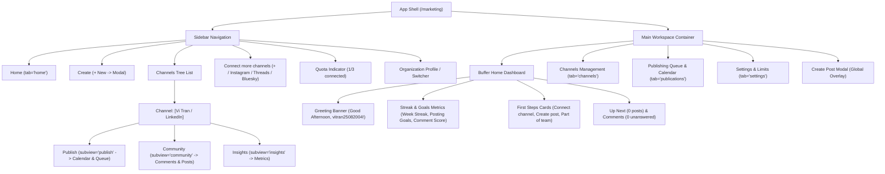

# 02. Page & Subview Map

## Detailed Route and State Specification

### 1. `/marketing` (Root Shell)
- **State `tab: 'home'`**:
  - Authentic Buffer Home Dashboard.
  - Greeting card with user/brand name.
  - Metric badges.
  - Quick action setup cards.
  - Up Next and Comments overview.
- **State `tab: 'channels'`**:
  - Multi-platform connection grid.
  - Platform cards: LinkedIn (API/OAuth), DEV Community (API Key), Medium (Manual/Assisted), Indie Hackers, Facebook Groups.
- **State `tab: 'publications'` / Subview `publish`**:
  - Content calendar with Month / Week grid toggle.
  - Scheduled queue list.
  - Post status pills and filters.
- **State Subview `community`**:
  - Channel-specific feed and interaction dashboard.
- **State Subview `insights`**:
  - Publication performance analytics.

### 2. Global Overlays
- **`editor: 'new' | PostObject`**:
  - Buffer Create Post modal with channel selection, live LinkedIn preview, tags, first comment, media upload, and schedule/post button.
- **`brandForm: object`**:
  - Brand/Workspace configuration modal.
