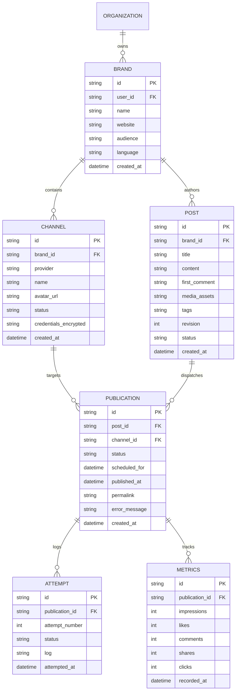

# 05. Data Model & Storage Schema

The local architecture uses SQLite (compatible with Cloudflare D1) managed via `apps/server` and Cloudflare Worker bindings.

## 1. Entity Relationship Diagram

## 2. Table Specifications

### `channels`
- `id` (TEXT, Primary Key)
- `brand_id` (TEXT, Foreign Key -> `brands.id`)
- `provider` (TEXT): `'linkedin'`, `'dev'`, `'medium'`, `'indiehackers'`, `'facebook_groups'`
- `name` (TEXT): Account or page display name (e.g. "Vi Tran", "DEV browser fixture")
- `avatar_url` (TEXT): Profile photo or platform icon
- `status` (TEXT): `'connected'`, `'needs_reauth'`, `'disconnected'`
- `credentials_encrypted` (TEXT): JSON payload storing tokens, API keys, or cookies

### `posts`
- `id` (TEXT, Primary Key)
- `brand_id` (TEXT, Foreign Key -> `brands.id`)
- `title` (TEXT): Optional internal post label
- `content` (TEXT): Post markdown or plain text
- `first_comment` (TEXT): Optional initial comment automatically scheduled with the post
- `media_assets` (TEXT): JSON array of asset URLs or IDs
- `tags` (TEXT): JSON array of category or campaign tags
- `revision` (INTEGER): Optimistic concurrency and audit version counter
- `status` (TEXT): `'draft'`, `'approved'`, `'scheduled'`, `'published'`

### `publications`
- `id` (TEXT, Primary Key)
- `post_id` (TEXT, Foreign Key -> `posts.id`)
- `channel_id` (TEXT, Foreign Key -> `channels.id`)
- `status` (TEXT): `'scheduled'`, `'publishing'`, `'published'`, `'awaiting_manual'`, `'failed'`, `'user_reported_published'`
- `scheduled_for` (TEXT, ISO-8601): Scheduled dispatch timestamp
- `permalink` (TEXT): External social media post URL
